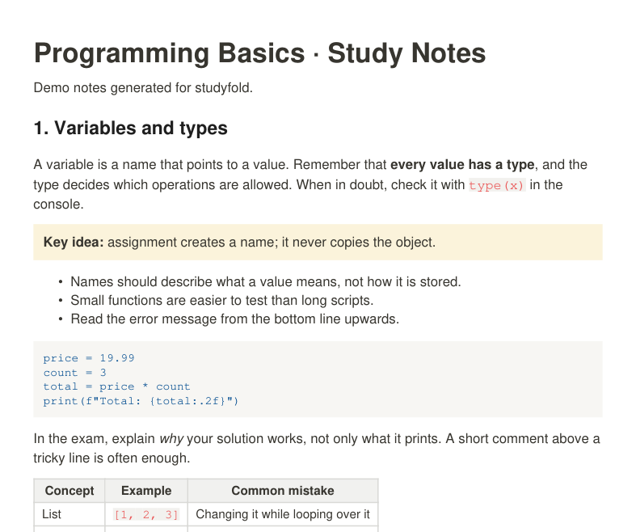
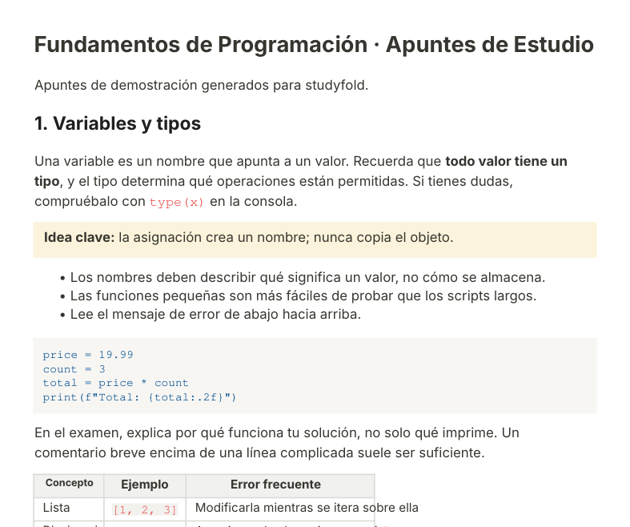
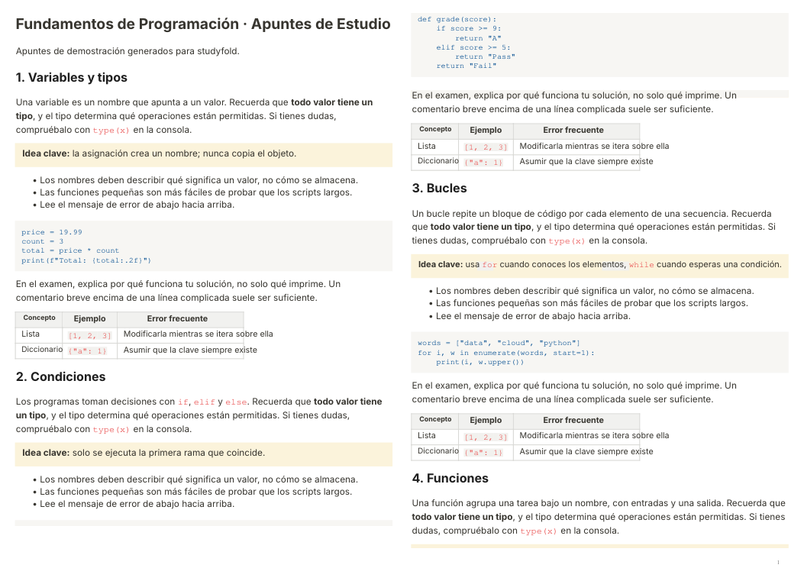
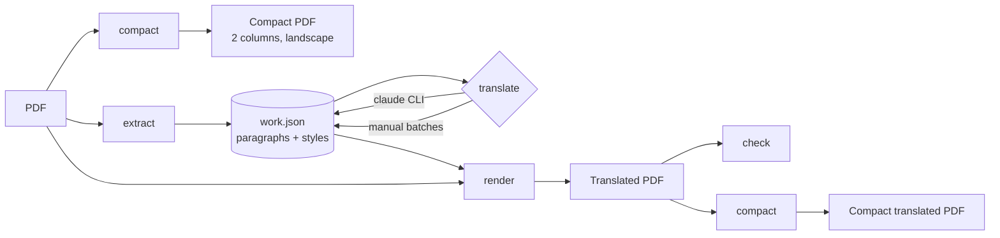

# studyfold

**Turn 150 pages of lecture notes into 60 – in your own language – without losing a single diagram.**

studyfold takes study-note PDFs (Notion exports, Word exports, slide handouts) and

1. **compacts** them: pages are re-flowed into two dense columns on landscape A4, cutting only in the blank gaps between lines, so nothing gets sliced in half;
2. **translates** them *in place*: every paragraph is replaced by its translation in the same spot, with the same colours, bold, links and emojis – while **code, formulas and images stay untouched**.

| Original (English, portrait) | Translated in place (Spanish) |
|---|---|
|  |  |

**Compacted translation, 2 columns per page:**



*(Screenshots come from [`examples/demo_notes.pdf`](examples/demo_notes.pdf), a demo document generated by [`examples/make_demo_pdf.py`](examples/make_demo_pdf.py).)*

---

## Why I built this

I study a master's degree taught in English. My course notes live in Notion and export to
long PDFs full of code blocks, tables and diagrams. I wanted two things before exams:
*fewer pages to print and revise*, and *a Spanish version to check concepts quickly* –
but copy-pasting into a translator destroys the layout, and "compress PDF" tools only
shrink the file, not the page count.

On my own course notes (not included here) it took a 156-page document to 68 pages, and
a 134-page one to 56, in both languages.

## How it works



| Step | What happens | Key idea |
|---|---|---|
| **compact** | Each page is cut into horizontal strips that are placed column after column as vector copies. | Cuts are only made where no text line, image or drawing crosses, so text stays selectable and sharp. |
| **extract** | Text spans are grouped into paragraphs by position, font size and style. Each paragraph is stored as light markup: `<r0>bold</r0>`, `<k0>code</k0>`, `<br>`, `<e0/>` (emoji). | Headings, list items and code lines are never merged into neighbouring paragraphs. |
| **translate** | Paragraphs are sent in batches; every answer is validated. | A translation is accepted **only if it keeps exactly the same tags** as its source, so styles and code can't be lost or invented. Progress is saved after every batch, so you can stop and resume. |
| **render** | The original words are removed (redaction) and the translation is typeset into the same box with PyMuPDF's HTML engine. | If the translation is longer, it grows into empty space below or shrinks slightly – it never covers other text. Unchanged paragraphs (code, formulas) are not touched at all. |
| **check** | Lists paragraphs of the result that still read as English. | Quick quality gate before printing. |

The code lives in [`src/studyfold`](src/studyfold): `compact.py`, `layout.py` (extract / render / check), `translators.py`, `pages.py` (sections, bands) and `cli.py`.

## Install

Requirements: **Python 3.10+**. Translation with the default backend also needs the
[Claude Code](https://docs.claude.com/en/docs/claude-code) CLI (`claude`) installed and logged in.

```bash
git clone https://github.com/<your-username>/studyfold.git
cd studyfold
python3 -m venv .venv
source .venv/bin/activate        # Windows: .venv\Scripts\activate
pip install -e .
```

Check it works:

```bash
studyfold --version
python examples/make_demo_pdf.py          # creates examples/demo_notes.pdf
studyfold compact examples/demo_notes.pdf
```

**Optional – best typography:** translated text is set in [Inter](https://rsms.me/inter/)
(the font Notion uses) if it is installed (`brew install --cask font-inter` on macOS, or
download it and put the `.otf` files in a folder set as `STUDYFOLD_FONTS`). Without it, a
built-in sans-serif font is used.

## Usage

**Everything in one go** (compact, translate, render, check, compact the translation):

```bash
studyfold run my_notes.pdf --lang es --subject "databases" -o out/
```

You get `out/my_notes_compact.pdf`, `out/my_notes_es.pdf` and `out/my_notes_es_compact.pdf`.
If it stops halfway (for example a usage limit), run the same command again: it resumes.

**Step by step:**

```bash
studyfold compact notes.pdf -o notes_compact.pdf
studyfold extract notes.pdf -w notes.work.json
studyfold translate notes.work.json --lang es
studyfold render notes.pdf notes.work.json -o notes_es.pdf
studyfold check notes_es.pdf --lang es
```

**Only one chapter of a long PDF:**

```bash
studyfold section notes.pdf --start "Airplane Queries" --end "Topic 15" -o airplanes.pdf
studyfold section notes.pdf --pages 86-115 -o airplanes.pdf
```

**Remove a stamp or watermark band** (e.g. a "downloaded by…" footer added by a sharing site):

```bash
studyfold strip notes.pdf --below 775 -o notes_clean.pdf
```

**Translate without the Claude CLI** – export batches, translate them with any tool, import them back:

```bash
studyfold export notes.work.json batches/ --lang es   # writes batch_000.json … + PROMPT.txt
# translate each batch_NNN.json and save the answer as batch_NNN.tr.json
studyfold import notes.work.json batches/
```

Re-use translations you already have when a new version of the same notes comes out:

```bash
studyfold extract notes_v2.pdf -w v2.work.json --reuse notes.work.json
```

Supported `--lang` codes for the quality check: `es`, `fr`, `it`, `de`, `pt` (translation itself works for any language name).

## Troubleshooting

| Problem | Solution |
|---|---|
| `translator unavailable: the claude command was not found` | Install Claude Code and run `claude` once to log in, or use `studyfold export` / `import`. |
| `translator unavailable: … usage limit` / `401` | Your session or quota ran out. Progress is saved – log in again (`claude`) and rerun the same command. |
| `N paragraphs are not translated yet` when rendering | Run `studyfold translate` again; it only sends the missing ones. Paragraphs whose answer broke the tags are retried in smaller batches. |
| Text in the compact PDF is too small | Your PDF has very wide content (wide tables). Try `--cols 1`, or cut out the section you need first. |
| A running footer or page number shows up in the middle of the columns | Increase `--footer` (pt ignored at the bottom of each page). |
| Fonts look different from the original | Install Inter (see Install). Code keeps a monospace font either way. |

## Limitations (honest list)

- Text **inside images** (screenshots, slide pictures, diagrams) is not translated.
- Code is kept as is; comments inside code blocks are usually translated by the model, but not guaranteed.
- Long translations in narrow **table cells** may be shrunk or slightly overflow the cell border.
- Scanned PDFs (no text layer) are compacted but cannot be translated – run OCR first.
- The paragraph detection is tuned on Notion and Word exports; unusual layouts may need tweaks.

## Now

Working on: an `anthropic` API backend (no CLI needed) and keeping the original
inline-code highlight when a translated line re-wraps.

## Development

```bash
pip install -e ".[dev]"
pytest
```

The tests build the demo PDF and run the whole pipeline with a fake translator, so they
need no network. CI runs them on every push ([`.github/workflows/tests.yml`](.github/workflows/tests.yml)).

Built with [PyMuPDF](https://pymupdf.readthedocs.io/). Developed with the help of
Claude Code (AI pair programming); the problem, design decisions and testing on real
course material are mine.

## License

[MIT](LICENSE)
